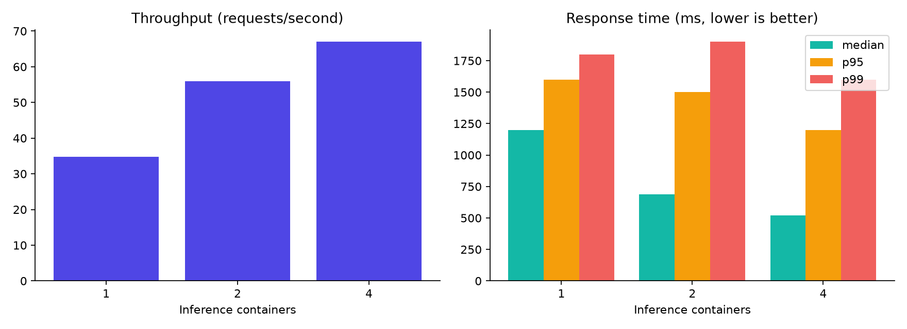

# PneumoScan: an end-to-end MLOps pipeline for chest X-ray classification

A complete machine-learning cycle on **image data**: data acquisition, preprocessing, model training, evaluation, a prediction API, a web UI, **bulk upload with one-click and automatic retraining**, Docker packaging, a load balancer, and a Locust flood test with 1, 2 and 4 model containers.

| | |
|---|---|
| **Video demo (YouTube)** | **TODO: paste the YouTube link** |
| **Live URL** | **TODO: add the public URL here if you deploy to a cloud VM, otherwise delete this row** (the stack runs with one command, see [Quick start](#quick-start-docker)) |
| **GitHub repository** | https://github.com/Nina-Cyndy/summative-pneumonia-mlops |

> **Disclaimer.** This is an educational project trained on a public dataset. It is not a medical device and must not be used for diagnosis.

---

## 1. Project description

**Task.** Classify a chest X-ray as `Normal` or `Pneumonia`. This continues the healthcare theme of the Introduction to ML summative (hospital readmission), but with non-tabular data, as the MLOps brief requires.

**Dataset.** [Chest X-Ray Images (Pneumonia)](https://www.kaggle.com/datasets/paultimothymooney/chest-xray-pneumonia) from Kaggle.

| Split | Normal | Pneumonia | Notes |
|---|---|---|---|
| Train | 1,349 | 2,000 | Kaggle's own train folder plus its 16-image validation folder; pneumonia capped at 2,000 to soften the class imbalance and keep the repo small |
| Test | 234 | 390 | Kaggle's own test folder, never used for training or tuning |

Kaggle's original train/test split is kept on purpose: the same patient often has several X-rays, so a random re-split could leak a patient into both sets and inflate the scores. Images are stored resized to 256x256; the model input is 224x224.

**What the system does**

1. **Predict**: upload one X-ray, get the class, the confidence and the response time.
2. **Visualise**: class balance and three image features (overall brightness, contrast, central-lung brightness), each with an interpretation.
3. **Monitor**: live uptime, requests served, latency, model version, and the metrics of the model currently in production.
4. **Upload data**: bulk-upload labelled X-rays (saved to disk, recorded in a SQLite database).
5. **Retrain**: press a button, or let the automatic trigger fire when 50 new images are waiting. The saved model is fine-tuned on the new data plus a replay sample of the old data, then compared with the current model on the test set. It replaces the current model only if it is not worse.

---

## 2. Architecture

```
Browser --> Streamlit UI (:8501) --+
Locust / API clients --------------+--> Nginx (:8000) --+--> /predict --> inference x 1, 2 or 4  (stateless)
                                                        +--> everything else --> control x 1
                                                              (upload, retraining, metrics, dashboards)
Shared volumes: models/  |  data/uploads/  |  SQLite (uploads, retraining runs, serving statistics)
```

* **inference** replicas only serve `/predict`. Scale them with `docker compose up -d --scale inference=N`.
* **control** is a single instance, because retraining state lives in one process. Training is therefore separated from serving.
* When a retrained model is promoted, the model file is replaced atomically and every inference replica reloads it on its next request.
* Each replica reports its counters to a shared table, so the Monitor page shows totals across all replicas.

---

## 3. Model and evaluation (notebook: `notebook/pneumonia_mlops.ipynb`)

**Preprocessing.** Corrupt-image check, RGB conversion, resize to 224x224, rescaling to [-1, 1] *inside* the model (so training and serving cannot disagree), augmentation on training data only (horizontal flip, small rotation, zoom, contrast; no vertical flips because X-rays have a fixed orientation), 80/20 train/validation split with a fixed seed, class weights for the imbalance.

**Models compared**

* **Baseline**: small CNN trained from scratch with no optimisation techniques.
* **Optimised**: MobileNetV2 transfer learning (ImageNet weights) with a two-phase schedule (train the new head, then fine-tune the top 30 layers at a learning rate of 1e-5), dropout (0.4), L2 weight decay, Adam, `ReduceLROnPlateau`, early stopping with best-weight restore, class weights and augmentation.

**Test-set results (624 images; positive class = Pneumonia)**

| Metric | Baseline CNN | MobileNetV2 (optimised) |
|---|---|---|
| Loss | 0.7073 | 0.3781 |
| Accuracy | 0.7692 | 0.8734 |
| Precision | 0.7402 | 0.8373 |
| Recall | 0.9718 | 0.9897 |
| F1 | 0.8404 | 0.9072 |
| AUC | 0.9166 | 0.9728 |

Confusion matrix of the optimised model (rows = actual, columns = predicted):

| | Pred. Normal | Pred. Pneumonia |
|---|---|---|
| **Actual Normal** | 159 | 75 |
| **Actual Pneumonia** | 4 | 386 |

**Interpretation.** The optimised model beats the baseline on every metric. It misses only 4 of 390 pneumonia cases (recall 0.990) but raises 75 false alarms on 234 normal X-rays, a cautious bias that is the safer direction for screening. Validation accuracy reached about 97% while test accuracy is 87%: validation images come from the same pool as the training images (and may share patients), whereas Kaggle's test set was collected separately, so this gap is most likely **dataset shift**. The high AUC (0.973) shows the model still ranks pneumonia above normal well.

### Retraining runs (from the Retrain Studio page)

| Run | Trigger | New images | Epochs | F1 before to after | Outcome |
|---|---|---|---|---|---|
| #1 | automatic (60 pending >= 50) | 60 | 3 | 0.907 to 0.880 | **Rejected**: F1 fell by more than the 0.02 tolerance, old model kept |
| #2 | manual button | 71 | 5 | 0.907 to 0.892 | **Promoted**: recall rose 0.990 to 0.997, F1 stayed within tolerance |

The promotion rule favours recall because missing a case is the costlier error: the new model must keep F1 and recall within `RETRAIN_MIN_DELTA` (default 0.02) of the current model. Run #2 was promoted although its accuracy (0.873 to 0.849) and precision (0.837 to 0.807) were lower; set `RETRAIN_MIN_DELTA=0` for a stricter rule. The demo images used for these runs were drawn from Kaggle's original *train* folder (never from the test set), so some overlap with the training data is possible; they demonstrate the mechanics of the pipeline, not new clinical knowledge.

---

## 4. Flood-request simulation (Locust)

**Setup.** `POST /predict` with real X-ray images from `data/test`, **50 simulated users**, spawn rate 10 users/s, **60 seconds per run**, 0.05 to 0.25 s between requests per user. Locust and Docker Desktop ran on the **same MacBook** (Docker Desktop CPUs: **TODO: write the number from Docker Desktop > Settings > Resources**). Each inference container is limited to one TensorFlow CPU thread so replicas scale fairly. Nginx balances round-robin.

| Inference containers | Requests | Failures | Throughput (req/s) | Avg (ms) | Median (ms) | p95 (ms) | p99 (ms) | Max (ms) |
|---|---|---|---|---|---|---|---|---|
| 1 | 1,984 | 0 (0.0%) | 34.7 | 1224 | 1200 | 1600 | 1800 | 1824 |
| 2 | 3,305 | 0 (0.0%) | 55.9 | 706 | 690 | 1500 | 1900 | 2023 |
| 4 | 3,961 | 0 (0.0%) | 67.0 | 565 | 520 | 1200 | 1600 | 2360 |



**Reading the results**

* No request failed in any run.
* Nginx spread the load evenly: 50% / 50% across two containers and about 25% each across four (`results/served_n*.json`).
* **One container is saturated.** It handles about 35 predictions per second (roughly 29 ms each on one thread), so with 50 users hammering it most of the 1.2 s median is queueing, not inference.
* Two containers gave 1.6x the throughput and four gave 1.9x, with the median response time falling 57% (1200 ms to 520 ms). Scaling is not linear because all containers, Nginx and Locust share the CPU cores of one laptop; more containers help only up to the number of cores available.
* The table comes from Locust's CSV, which is written every few seconds, so request counts can differ from the final terminal summary by under 1%.

---

## 5. Quick start (Docker)

Requires Docker Desktop (or Docker Engine with the Compose plugin).

```bash
git clone https://github.com/Nina-Cyndy/summative-pneumonia-mlops.git
cd summative-pneumonia-mlops
docker compose up -d --build        # first build takes 5-15 minutes (TensorFlow)
docker compose ps                   # all services should become "healthy"
```

* UI: http://localhost:8501
* API docs (Swagger): http://localhost:8000/docs
* Scale the model API: `docker compose up -d --scale inference=4`
* Logs: `docker compose logs -f control`
* Stop: `docker compose down` (add `-v` to also delete the model, uploads and database volumes)

The image bakes in `models/` and `data/train`, `data/test`. If the first start finds the named volume empty, Docker seeds it from the image.

### Run the flood test

```bash
pip install locust matplotlib                     # or use the conda environment below
bash scripts/run_load_tests.sh                     # tests 1, 2 and 4 containers (about 5 minutes)
python scripts/summarize_load_tests.py             # writes results/summary.md and results/load_test_summary.png
```

Options: `USERS=100 SPAWN=20 DURATION=90s COUNTS="1 2 4" bash scripts/run_load_tests.sh`. To test a remote server, see the header of `scripts/run_load_tests.sh`.

---

## 6. Run without Docker (development)

TensorFlow 2.15 needs **Python 3.9 to 3.11**.

```bash
conda create -n pneumonia python=3.11 -y
conda activate pneumonia
pip install -r requirements.txt

python scripts/download_data.py            # optional: rebuilds data/train and data/test from Kaggle (needs Kaggle login)
jupyter lab                                # open notebook/pneumonia_mlops.ipynb, kernel "Python 3.11 (pneumonia)"

python -m uvicorn api.main:app --port 8000                     # terminal 1: API
streamlit run ui/app.py --server.address 127.0.0.1             # terminal 2: UI
```

The notebook saves `models/pneumonia_model.h5`, `models/class_names.json` and `models/metrics.json`, which the API and UI read. If you skip the data download, the repository already contains the processed `data/train` and `data/test`.

---

## 7. How to use the system

1. **Diagnose**: drop an X-ray; press *Analyse X-ray*.
2. **Data Insights**: class balance and three feature distributions with interpretations.
3. **Model Monitor**: uptime (refreshes every 5 s), predictions served, latency, model version, metrics and confusion matrix of the production model.
4. **Retrain Studio**:
   1. choose the class, select many images, press *Upload*: each image is validated, converted to RGB, resized and saved to `data/uploads/<class>/`, and recorded in SQLite (exact duplicates are skipped);
   2. retraining starts automatically when the pending count reaches `RETRAIN_THRESHOLD` (default 50), or press *Start retraining now*;
   3. review the result: old vs new metrics, whether the new model was promoted, and the history of all runs.

To practise the retraining flow: `python -m scripts.make_demo_uploads` creates `demo_uploads/` with 30 images per class. **Never upload images from `data/test/`**; they decide whether a retrained model is promoted.

### API endpoints

| Method and path | Purpose |
|---|---|
| `POST /predict` | classify one image (`file`); returns label, confidence, probabilities, latency, `served_by` |
| `GET /health` | uptime, replicas online, requests served, average latency, model version |
| `POST /upload` | bulk upload (`label` + several `files`) |
| `POST /retrain` | manual retraining trigger |
| `GET /retrain/status`, `GET /retrain/history` | live status and all past runs |
| `GET /metrics` | evaluation of the model in production |
| `GET /data/summary`, `GET /insights` | class counts and image-feature statistics for the dashboards |

### Configuration (environment variables)

| Variable | Default | Meaning |
|---|---|---|
| `AUTO_RETRAIN` / `RETRAIN_THRESHOLD` | `true` / `50` | automatic trigger and number of pending uploads that fires it |
| `RETRAIN_EPOCHS`, `RETRAIN_LR`, `RETRAIN_UNFREEZE` | `5`, `3e-5`, `30` | fine-tuning epochs, learning rate, number of base layers unfrozen |
| `REPLAY_PER_CLASS` | `400` | old training images per class mixed into every retraining |
| `RETRAIN_MIN_DELTA` | `0.02` | tolerated drop in F1 and recall for a new model to be promoted |
| `TF_INTRA_THREADS`, `TF_INTER_THREADS` | `1` in Docker | CPU threads per inference container |

---

## 8. Repository structure

```
summative-pneumonia-mlops/
├── README.md
├── notebook/pneumonia_mlops.ipynb      preprocessing, training, evaluation, prediction test
├── src/
│   ├── preprocessing.py                cleaning, tf.data pipelines, augmentation, single-image preprocessing
│   ├── model.py                        architectures, two-phase training, evaluation, saving
│   ├── prediction.py                   cached model loading, auto-reload, prediction
│   ├── retrain.py                      retraining pipeline (loads the saved model and fine-tunes it)
│   ├── ingest.py                       validation + preprocessing of uploaded images
│   ├── database.py                     SQLite: uploads, retraining runs, serving statistics
│   └── insights.py                     image-feature statistics for the dashboard
├── api/main.py                         FastAPI service
├── ui/app.py                           Streamlit console (4 pages)
├── data/train, data/test               processed dataset (data/uploads is created at runtime)
├── models/                             pneumonia_model.h5, class_names.json, metrics.json
├── locust/locustfile.py                flood test
├── scripts/                            download_data, make_demo_uploads, run_load_tests, summarize_load_tests
├── results/                            Locust CSVs, summary.md, load_test_summary.png
├── deploy/nginx.conf                   load balancer
├── Dockerfile.api, Dockerfile.ui, docker-compose.yml
└── requirements*.txt
```

## 9. Mapping to the assignment

| Requirement | Where |
|---|---|
| Data acquisition, processing, model creation, testing | `scripts/download_data.py`, `src/preprocessing.py`, `src/model.py`, notebook |
| Retraining with a trigger | `src/retrain.py`; manual button and automatic threshold in `api/main.py` |
| API with Python | `api/main.py` (FastAPI) |
| UI: uptime, visualisations, train/retrain access | `ui/app.py` |
| Deployment, evaluation in production | `docker-compose.yml`; Model Monitor page and `/metrics` |
| Flood simulation with different numbers of containers | `locust/locustfile.py`, section 4 |
| Predict one image; bulk upload; retrain button | Diagnose and Retrain Studio pages |

## 10. Limitations

* Single public dataset; no clinical validation. Test accuracy (87%) is far below validation accuracy (97%), most likely because of dataset shift.
* Label quality is the user's responsibility: wrongly labelled uploads teach the model wrong patterns. The promotion gate limits but does not remove the damage.
* The retrain endpoint is open: anyone who can reach the server can upload and retrain. Put authentication in front of it before any real deployment.
* The shared SQLite database and volumes suit a single host; a multi-host deployment would need a managed database and object storage.
* Load-test numbers depend on the machine: Locust, Nginx and the containers shared one laptop.